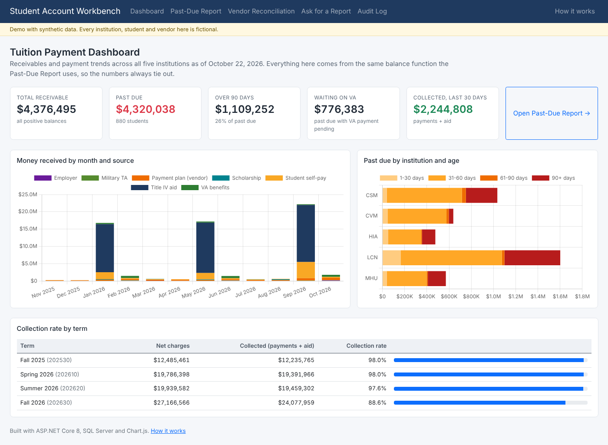
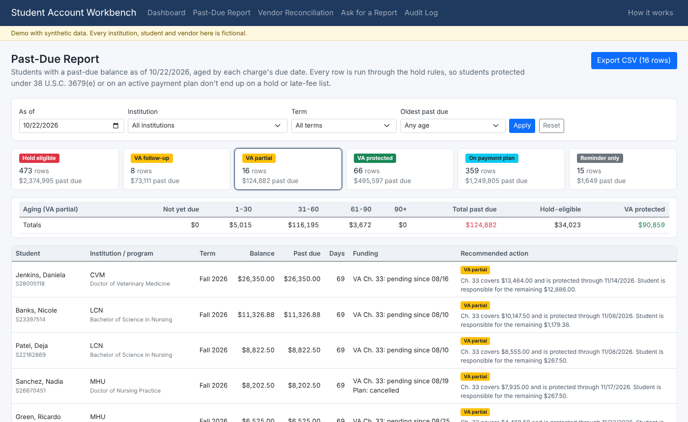
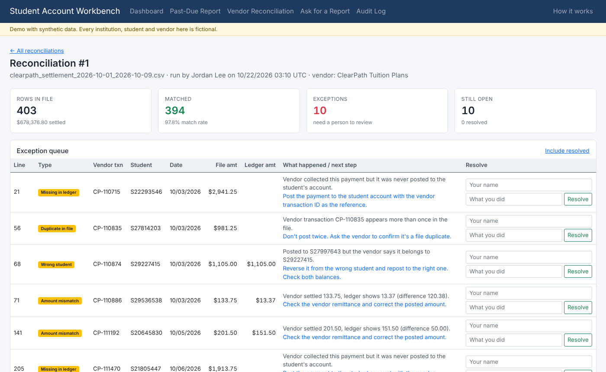

# Student Account Workbench

A student finance reporting and reconciliation tool built on SQL Server and ASP.NET Core. It covers three requests a Student Finance team makes all the time:

1. **"Send me the students with past-due balances."** Aged past-due report where every row is checked against the hold rules: VA pending-payment protection under 38 U.S.C. 3679(e), active payment plans, and a minimum balance threshold.
2. **"Build me a dashboard of tuition payment trends."** Receivables, money received by fund source, past due by institution and age, and collection rate by term.
3. **"The payment plan vendor's file doesn't match what we posted."** Upload the vendor settlement file, compare it to the ledger, and work an exception queue with an audit trail.

Plus **Ask for a Report**: type a question in plain English, AI drafts the SQL, a person reviews it, and it runs under a read-only login that can only see de-identified reporting views.

All data is synthetic: about 2,500 made-up students across five fictional institutions.



## What's worth looking at

| | Where |
|---|---|
| FIFO AR aging in one inline table-valued function (window functions) that every report reads from | [`db/02_views.sql`](db/02_views.sql) |
| VA 3679(e) protection, payment plan and threshold rules, with tests for the 90-day boundary and partial coverage | [`HoldPolicy.cs`](src/Workbench.Core/PastDue/HoldPolicy.cs), [tests](tests/Workbench.Tests/HoldPolicyTests.cs) |
| Vendor file reconciliation: 7 exception types, never posts anything | [`PaymentMatcher.cs`](src/Workbench.Core/Reconciliation/PaymentMatcher.cs) |
| AI SQL guard using Microsoft's T-SQL parser (ScriptDom), not keyword matching | [`ReportSqlGuard.cs`](src/Workbench.Core/Reporting/ReportSqlGuard.cs) |
| Least-privilege logins: AI SQL runs as a user with SELECT on `rpt` only | [`db/04_security.sql`](db/04_security.sql) |
| Synthetic data with Title IV disbursements, credit balance refunds, R2T4, VA, TA, payment plans, late payers | [`tools/generate_seed_data.py`](tools/generate_seed_data.py) |
| Requirements, UAT test plan, data dictionary | [`docs/`](docs) |

## Screens

| Past-Due Report (VA partially protected) | Vendor reconciliation exceptions |
|---|---|
|  |  |

## Stack

- **SQL Server / Azure SQL**: schema, inline TVF for balances and aging, stored procedures for each report, two database logins
- **C# / ASP.NET Core 8 Razor Pages**, Dapper, Bootstrap, Chart.js
- **Workbench.Core** class library for business rules (no database dependency, reusable from a WinForms tool or batch job)
- **xUnit**: 52 tests
- **Google Gemini** for drafting SQL from plain English (optional)
- **Python** for the synthetic data generator

```
src/Workbench.Core/     business rules: hold policy, vendor file parser, payment matcher, SQL guard
src/Workbench.Web/      Razor Pages UI, Dapper repositories, Gemini client
tests/Workbench.Tests/  xUnit tests for Core
db/                     schema, views/function, procedures, security, generated seed data
tools/                  data generator, database setup script
samples/                vendor settlement file with planted exceptions
docs/                   requirements, UAT plan, data dictionary
```

## Run it locally (Mac)

### One-time installs

1. **Docker Desktop**: https://www.docker.com/products/docker-desktop/ . Open it once. On an Apple Silicon Mac, go to Settings > General and turn on "Use Rosetta for x86_64/amd64 emulation".
2. **.NET 8 SDK**: the macOS installer from https://dotnet.microsoft.com/download/dotnet/8.0 (Arm64 for Apple Silicon, x64 for Intel). It has to be 8; a newer SDK alone won't run this app.
3. **sqlcmd**: `brew install sqlcmd`
4. **Get the code** (then stay in this folder for everything below):

```bash
git clone -b claude/serene-bohr-omzu20 https://github.com/waqarahmed1011/student-finance-project.git
cd student-finance-project
```

### Start it

Paste each block one at a time.

Start SQL Server, then wait about 30 seconds:

```bash
docker run -d --name sfw-sql -e ACCEPT_EULA=Y -e 'MSSQL_SA_PASSWORD=Dev!Passw0rd123' -p 1433:1433 mcr.microsoft.com/mssql/server:2022-latest
```

Load the schema and data:

```bash
SQL_SERVER=localhost SQL_ADMIN_USER=sa SQL_ADMIN_PASSWORD='Dev!Passw0rd123' APP_PASSWORD='App!Passw0rd123' READER_PASSWORD='Read!Passw0rd123' bash tools/setup-database.sh
```

Create the local settings file (already has the passwords above):

```bash
cp src/Workbench.Web/appsettings.Development.example.json src/Workbench.Web/appsettings.Development.json
```

Run the app and open the http://localhost address it prints:

```bash
dotnet run --project src/Workbench.Web
```

Run the tests (in a second terminal tab, same folder):

```bash
dotnet test
```

Next time: open Docker Desktop, run `docker start sfw-sql`, then `dotnet run --project src/Workbench.Web`.

To regenerate the data: `python3 tools/generate_seed_data.py` (deterministic, fixed seed).

Deploying to Azure: see [DEPLOY.md](DEPLOY.md).

## Simplifications

- VA protection assumes the student already submitted their certificate of eligibility.
- No login. It's a public demo with fake data; a real version would use SSO and roles.
- Reconciliation reports differences only. Posting corrections would go through the student system.
- One payment plan vendor and one file format.
